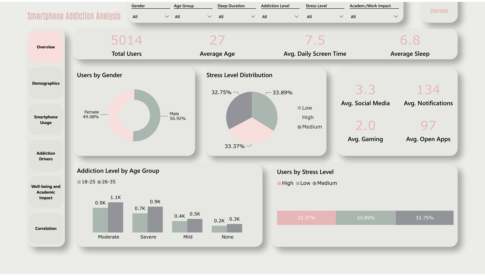

# Smartphone Addiction Analysis 

This project focuses on analyzing smartphone addiction levels and exploring their relationships with daily habits, sleep patterns, stress levels, and academic or work performance.

The goal is to transform raw data into meaningful insights through an interactive Power BI dashboard, helping users better understand the potential factors associated with smartphone addiction.

The project demonstrates data cleaning, data modeling, analytical calculations, and data visualization using Microsoft Power BI.

## Project Overview

The dashboard provides an overview of smartphone addiction patterns across different user groups.

It explores the relationships between smartphone usage, gaming habits, sleep duration, stress levels, and academic or work performance.

The analysis is organized into several key areas:

- **Addiction Overview** — distribution of smartphone addiction levels and key user metrics.
- **Addiction Drivers** — analysis of screen time, gaming habits, and other behavioral factors associated with addiction.
- **Well-being & Academic Impact** — exploration of sleep duration, stress levels, and reported academic or work performance.
- **Correlation Analysis** — investigation of relationships between addiction levels and daily habits.

Interactive filters allow users to explore the data and compare patterns across different demographic groups.

## Business Context

Smartphones have become an essential part of everyday life, supporting communication, education, entertainment, and work.

However, excessive smartphone use may be associated with changes in sleep patterns, increased stress, and challenges in maintaining academic or work performance.

Understanding these patterns can help identify user groups and behavioral characteristics that deserve further attention.

This project approaches smartphone addiction as a data analysis problem, using descriptive analytics and visualizations to explore patterns within the dataset.

The analysis focuses on answering questions such as:

- How are users distributed across different smartphone addiction levels?
- How does daily screen time vary between addiction groups?
- What relationships exist between smartphone usage, gaming habits, and sleep duration?
- How are stress levels distributed across different addiction groups?
- How does reported academic or work impact vary by age group?
- Which behavioral indicators show the strongest relationships with addiction levels?

## Business Value

The dashboard demonstrates how data analytics can support a better understanding of smartphone usage behavior.

Key benefits include:

- **Behavioral Insights** — identify patterns in smartphone usage and related daily habits.
- **Group Comparison** — compare addiction levels across different demographic groups.
- **Well-being Analysis** — explore associations between smartphone use, sleep duration, and stress levels.
- **Academic & Work Insights** — examine reported performance impacts across user groups.
- **Data-Driven Decision Support** — provide a structured analytical overview that can support further research and awareness initiatives.

The findings are exploratory and describe relationships within the available dataset. They do not establish causation or provide clinical diagnoses.

## Dashboard Features

The dashboard consists of four analytical sections:

- **Addiction Overview** — summarizes smartphone addiction levels and user distribution.
- **Addiction Drivers** — explores screen time, gaming habits, and other behavioral factors associated with addiction.
- **Well-being & Academic Impact** — examines sleep patterns, stress levels, and academic or work performance.
- **Correlation Analysis** — investigates relationships between addiction levels and key lifestyle indicators.

### Interactive Features

- Interactive filters and slicers
- Dynamic visualizations and cross-filtering
- Comparison of behavioral patterns across user groups

##  Tools & Techniques

- **SQL**
- **Microsoft Power BI**
- **Git & GitHub**
- **Techniques** - data cleaning and preprocessing, EDA, DAX measures and calculated columns, KPI metrics, data visualization, distribution analysis, correlation analysis, interactive dashboard design.

## Additional Useful Links

project: [click here](./power_bi/power_bi_smartphone_addiction.pbix)   
project .pdf: [click here](./deliverables/smartphone_addiction_dashboard.pdf)   
.csv dataset: [click here](./data/processed/smartphone_addiction_cleaned.csv).  
.sql scripts: [click here](./data/outputs/sql)